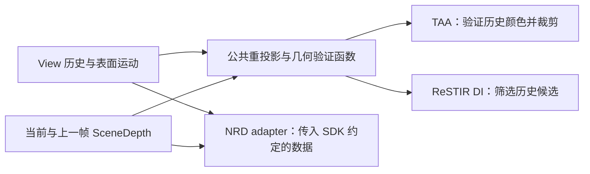

# 时域历史验证与去遮挡处理

状态：T1 用户已确认；T2 的相机及物体运动拖影已由用户验证改善，边缘噪声带和闪烁仍待处理；
T3 已完成 Intel / Microsoft TAA 质量路径的代码移植及静态检查，用户已确认本次修改并授权提交；专项验收结果尚未逐项记录。
按用户决定跳过 T0。2026-11-17。

本事项承接 [时序基础与 TAA](TODO_TemporalPlan.md)，复用现有 View、Velocity、RenderGraph 历史资源机制，
为跨帧重用建立一致的数据约定和 shader 工具。首个落地消费者为 TAA，后续供 NRD 接入和 ReSTIR DI 使用。

### 当前落地范围

- T1 已补齐 View 历史有效性、前一帧 view/深度参数与 SceneDepth 历史读取，公共工具位于
  `Shaders/Lib/Temporal/TemporalReprojection.hlsli`。
- T2 已把 `Velocity` / `ResolvedVelocity` 扩为 RGBA16F：RG 保持二维运动，B 保存对应点的 viewZ 差，A 标记表面深度运动有效。
- TAA 用中心深度加 B 预测上一帧 viewZ，支持静态与刚体运动表面；T3 恢复参考实现的最长速度邻域选择，
  保留完整代表样本并分别验证中心与代表点，不混用邻域 RG 与中心 B，也不使用 T1 的静态回投影/半像素限制。
- 历史深度查询扣除当前 jitter、补回上一帧 jitter；颜色历史仍按 unjittered 输出网格读取。
  T3 使用上一帧 2×2 有限几何深度中的最远 viewZ 做单侧遮挡检查，不再使用 T2 的单点绝对误差阈值。
- T3 深度偏置默认是前一帧远裁面 viewZ 的 `0.001`，加 B 的 FP16 量化误差；沿用参考归一化深度的单位，
  例如 far=1000 时允许 1 世界单位的深度偏置。它可能接受距离较近的不同表面，可通过新参数降低，属于验收重点。
- 历史保持线性 HDR RGB，A 改为递推权重；有效历史使用中心颜色，默认 5-tap bicubic，9 样本 YCoCg 方差裁剪。
  仅无历史时使用参考的中心加四个对角样本回退，已移除每帧 Gaussian 当前帧重建。
- View GPU 记录为 672 字节；T2 将 InstanceData 同步扩为 224 字节，新增实例历史有效字段并维护布局断言。
  实例首次出现、未就绪或显式 reset 时无效，静止且有真实历史时有效。
- `InstanceHistoryResetTag` 可由 teleport/拓扑替换调用方添加；编码后捕获新快照并消费 tag，下一帧恢复使用历史。
  不自动猜测 teleport，不支持骨骼/GPU 变形的上一帧状态。
- 天空的 RG 由齐次世界方向重投影，只随相机旋转变化，B/A 保持零。几何像素完整传递 RGBA。
- T2 补充了实例编码测试用例；代理按约定未编译或运行，画面由用户编译验证。未新增调试视图或 Pass。
- 用户已选择 Intel / Microsoft TAA 基准，不引入新的 SDK。保留 T1/T2 的资源、View、实例与运动数据基础；
  暂不实施自行设计的局部平面拟合、逐颜色 tap 几何过滤及覆盖权重方案，也不全面替换为双线性历史过滤。
  以下章节中，TAA 的具体策略以 §7 为准，公共数据约定继续适用。

## 1. 问题与目标

用户观察到相机平移时，物体轮廓和新露出的背景出现拖影，旋转时不明显。实现前静态检查确认 TAA 存在验证缺口：

- 原 `TemporalAA.hlsl` 的 `historyValid` 只检查颜色历史存在及重投影坐标在屏幕内。
- 原 `SceneDepth` 仅用于选择 3×3 邻域最近深度处的速度，没有读取上一帧深度。
- 最终 SceneColor 已包含未降噪的 1spp 直接光，颜色邻域裁剪难以独立判断几何历史是否可用。

这些事实支持去遮挡历史误用的判断，但尚未通过调试视图排除运动矢量或坐标映射错误。
按用户决定先实现机制，必要时回补调试视图；不能仅通过调低历史权重掩盖问题。

目标：

1. 拒绝被其他表面占据的历史位置，改善轮廓与去遮挡区域的拖影。
2. 正确处理静态场景的相机平移，以及具有前一帧变换的运动实例。
3. 统一 jitter、深度、运动与历史失效约定；公共函数不绑定具体降噪算法。
4. 保留各消费者自己的颜色、光照、镜面和 reservoir 策略。

本事项不实现 NRD、ReSTIR DI、visibility buffer、动态分辨率或透明物体的精确时域重建。
首次落地以当前单主视图、固定渲染尺寸、光栅不透明/裁剪表面为验证范围；坐标工具必须显式使用 view rect，
尺寸或 rect 改变时先拒绝历史，不假设图资源的全局名字已经解决多主视图隔离。

## 2. 设计边界

### 共用数据和几何工具，由消费者决定如何重用

| 层次 | 职责 | 所在位置 |
|---|---|---|
| 资源历史 | 提取当前图资源、导入上一帧、提供 missing 标志 | 现有 RenderGraph |
| 视图历史 | 前一帧变换与投影、jitter、连续性及重置状态 | ViewHistory / ViewBindingSystem |
| 表面运动 | 当前表面对应点的二维投影运动和深度变化 | GBuffer / VelocityResolve |
| 几何验证 | 坐标转换、深度一致性、有效采样权重 | 公共 HLSL |
| 信号策略 | 颜色裁剪、光照响应、反射重投影、reservoir 重采样 | TAA / NRD / ReSTIR 各自实现 |

不新增 HistoryManager、RHI 时域接口或固定执行的 HistoryValidationPass。
初版不分配全屏通用 rejection mask；公共函数的结果在消费 shader 中使用，调试模式需要时才输出可视化。
只有多个消费者实际采用相同坐标、采样位置和判定时，才评估把部分验证物化为共享纹理。



NRD 保留其内部去遮挡逻辑；不强迫它消费引擎的单个几何有效位。统一的输入约定和重置事件比强行共用最终判定更重要。

## 3. 历史资源

### 保留已有 SceneDepth，不增加深度复制 Pass

TAA 声明上一帧深度读取，由现有 `ReadPreviousImage` 机制请求本帧深度在帧末提取：

```cpp
s.ReadPreviousImage(RHI::AttachmentId("SceneDepth"))
    .Format(RHI::Format::R32_FLOAT)
    .Bind(RHI::InputName("g_PreviousDepth"))
    .BindValid(RHI::InputName("g_PreviousDepthValid"));
```

这与现有 TAA 颜色历史读取使用同一机制。底层保存原始 D32_FLOAT 图像，通过 R32_FLOAT SRV 读取；
不创建一份重复的 R32 线性深度历史，线性化使用上一帧的投影参数。

各消费者按需声明历史读取，同名资源由图共享。上一帧法线、材质等只在消费者实际需要时保留，初版不全部提取。
颜色、深度等历史必须分别检查 `BindValid`；颜色存在不能代表深度也存在。

初次使用、描述符变化、停用后恢复等资源失效沿用图的 missing 标志。缺失替身内容不可假设为零或有限数，
无效时选择当前帧结果，不通过乘零消除历史。

## 4. View 与运动数据

### 4.1 View 级历史有效性

在 View GPU 数据中表达 `temporalHistoryValid`，由唯一的 View 编码入口产生。
初始无历史、`ViewHistoryResetTag`、相机更换、不连续渲染、尺寸/rect 或投影约定不兼容时置零。

有效性必须在 `PreviousHistory()` 用当前帧补齐上一帧矩阵之前确定。补齐矩阵用于保持计算有限，不能把无历史变成有效历史。
消费者共同遵守：资源历史有效且视图历史有效，才允许读取并重用历史信号。

重置 tag 由 ViewBindingSystem 读取并消费，产生的有效位随 ViewBuffer 供整帧所有消费者使用。
这替代旧时序计划中“让 tag 保留整帧”的设想，无需每个消费者再次访问 CPU tag。

View 的 CPU/HLSL 镜像同步补充：

- `prevView`：前一帧 world-to-view，用于计算表面对应点的深度运动。
- `prevInvDeviceZToViewZ`：前一帧深度线性化参数，禁止用当前投影参数解码历史深度。
- `temporalHistoryValid`，以及 ViewHistory 中用于连续性判断的尺寸、rect、帧标识。
- 已有 `prevViewProjection` 和 `temporalAAJitter.zw` 继续复用。

字段变更时同步更新结构大小/布局断言。第一版尺寸、rect 或投影变化直接失效，不尝试历史重映射。

### 4.2 二维运动不足以验证运动实例

静态表面可以用当前世界位置投影到上一帧，得到预期历史深度。运动实例的对应点上一帧位于另一世界位置，
只靠当前深度和二维速度无法唯一恢复它的上一帧深度。

T2 已把 `Velocity` 和 `ResolvedVelocity` 从 RG16F 扩为 RGBA16F，不新增 MRT：

| 通道 | 含义 |
|---|---|
| RG | 当前 unjittered NDC − 上一帧 unjittered NDC；保持现有方向、尺度 |
| B | `previousViewZ - currentViewZ`，两者均为对应点在各自相机空间中的正线性深度 |
| A | 深度运动有效位；有效为 1，缺少对应点或不可表示时为 0 |

GBuffer 已有当前/上一帧顶点位置和实例变换，计算深度差并随 RG 写入。以透视正确插值的对应点计算，
不能先在顶点上执行透视除法再线性插值。实例首次出现时默认 `PrevModel == Model` 不等于已有实例历史，
深度验证通过实例有效字段处理首次出现与显式 reset；静止不意味着历史无效。

实例历史有效性由 `EncodeInstanceData` 根据真实的 `InstanceHistory` 和显式重置状态编码，
通过新增的实例历史有效字段传到 shader；同步维护 InstanceData 的 CPU/HLSL 布局和断言。
不通过比较 `Model == PrevModel` 推断有效性，静止实例也可能有完整历史。

RG 保留已有 unwritten sentinel。B 为 FP16，应检查有限性和范围；溢出或前一帧投影无效时清 A，禁止饱和截断后标记有效。
验证容差需覆盖 B 的量化误差。运动幅度超过可表达范围时拒绝历史即可。

VelocityResolve 对几何像素传递全部通道；原有仅使用 XY 的消费者保持运动语义，新增消费者显式读取 B/A。
天空不伪造表面深度运动：由相机旋转重投影世界方向，方向使用齐次 `w=0`，相机平移不产生无限远天空的运动。
天空的 A 为 0，由消费方走独立的 background 验证分支。

RGBA16F 在两张运动图上各增加 4 字节/像素；深度历史还会延长 SceneDepth 的存储生命周期。
这是本事项需要记录的成本，不能因为没有新增 Pass 就认为没有带宽或内存开销。

## 5. 重投影坐标与深度约定

必须区分三个坐标：当前 jittered 几何采样、上一帧 unjittered 历史颜色、上一帧 jittered 深度。
UV 均先定义为 view-local、Y 向下，再通过 rect/尺寸转换为各自纹理坐标。

对当前几何采样中心 `sampleRasterUV`：

```text
jitterUV     = currentJitterNDC  * (0.5, -0.5)
prevJitterUV = previousJitterNDC * (0.5, -0.5)
motionUV     = velocity.xy      * (0.5, -0.5)

sampleUnjitteredUV = sampleRasterUV - jitterUV
prevSampleUV      = sampleUnjitteredUV - motionUV
prevDepthUV       = prevSampleUV + prevJitterUV
expectedPrevViewZ = currentViewZ + velocity.z
```

这些公式描述几何采样代表点。TAA 输出像素中心是另一个位置，不能把它与代表点混为一谈。
原 TAA 用 `bestPx` 的速度重投影 `px`：在深度边界，两者可能属于不同表面。T1/T2 已改用中心样本。
T3 基准包含邻域速度膨胀，其作用是改善运动边缘覆盖，不是同一表面对应关系的证明；
必须说明速度代表像素、几何检查位置与颜色输出位置各自的含义，不能把膨胀后的速度与中心深度宣称为精确对应点。
适配时同时审查 RG、B、A 的来源与有效性，不能只替换 XY 而保留另一个样本的深度运动。

比较的深度全部处于上一帧相机的正线性 viewZ 域：

```text
actualPrevViewZ = Linearize(previousDeviceZ, previousProjectionParameters)
depthError     = abs(actualPrevViewZ - expectedPrevViewZ)
tolerance      = absoluteTolerance + relativeTolerance * expectedPrevViewZ
```

以上绝对误差检查是 T1/T2 的中间实现，并非 T3 的接受规则。T3 依据所选源码的邻域深度与遮挡判断重新适配，
处理 FP16 深度运动误差、线性深度单位及 reversed-Z。源码中的深度偏置不能直接视为引擎世界单位，见 §7。
本轮不额外设计表面斜率拟合；后续确有需求再单独评估，不能把前后景深度跳变解释为斜率来扩大容差。

当前/历史背景、投影位于相机背后、非法数值、越出 view rect 均需显式分类。
表面投影到历史背景时拒绝；当前天空仅在历史采样仍为背景且相机方向投影有效时允许天空颜色重用。

## 6. 公共 HLSL 的形状

新增 `Shaders/Lib/Temporal/TemporalReprojection.hlsli`，提供不绑定纹理寄存器的工具：

- NDC motion、view UV、buffer UV、jittered/unjittered 坐标转换。
- 表面代表点的历史坐标与预期 viewZ 计算。
- 带显式参数的深度一致性检查；法线相似性作为可选辅助函数。
- 按实际移植需要提供采样足迹与边界计算；TAA 专用的邻域深度、速度膨胀、裁剪与累积策略留在消费者中。

公共工具不直接返回通用的颜色混合系数，不把颜色/亮度差异解释为几何失效。
逐 tap 有效位与覆盖权重不是本轮强制接口；在未来消费者确有需要时再增加，不为尚未使用的策略建立抽象。

检查至少区分资源/视图无效、越界、非法运动、背景不匹配与深度不匹配；需要调试输出时再编码拒绝原因。
Sky 分支和无历史分支必须有确定结果，不能通过无效数据参与运算后再乘零。

不强制建立 C++ 策略类、虚接口或统一的累积器。各 Pass 继续通过现有 Scope 声明资源和常量。

## 7. T3：Intel / Microsoft TAA 质量路径移植

### 7.1 基准与范围

用户已确定采用公开原生 TAA 的质量路径，后续按引擎需求调整；本轮不引入 FSR、DLSS 等新的 SDK。

- 主要源码：[Intel Graphics Optimized TAA — TAAResolve.hlsl](https://github.com/GameTechDev/TAA/blob/39786709cf70a1e0906196c600f6079571a33ceb/MiniEngine/Core/Shaders/TAAResolve.hlsl)。
  已锁定提交 `39786709cf70a1e0906196c600f6079571a33ceb`，版权及 MIT 许可随移植代码保存在 Shader 文件顶部。
- 算法选项及输入说明：[Intel TAA README](https://github.com/GameTechDev/TAA)。该仓库已归档，用作可追溯源码基准。
- 对照说明：[Microsoft Temporal AntiAliasing 示例](https://learn.microsoft.com/en-us/samples/microsoft/xbox-gdk-samples/temporalantialiasing/)。
  Microsoft 示例的历史过滤参考 Intel 项目，不把两者视为完全相同的实现。
- 许可：[Intel / Microsoft MIT notices](https://github.com/GameTechDev/TAA/blob/39786709cf70a1e0906196c600f6079571a33ceb/License.txt)。

目标是移植一条可对照的完整质量路径，不只摘取深度比较函数后继续叠加自行设计的策略。
基准包括深度拒绝、邻域速度选择、5-tap bicubic、9 样本 YCoCg 方差裁剪、自适应 gamma 与历史权重递推。
先采用完整质量选项，再根据画面对照讨论取舍；不同时开展 FP16、groupshared 或 compute 优化。

本轮暂不实施局部平面拟合、完整 Catmull-Rom 足迹的逐颜色 tap 几何验证与自定义覆盖权重。
基准源码本身也包含启发式规则，不将其描述成精确的逐表面验证或无需调参的算法。

### 7.2 必须显式适配的输入与输出

| 项目 | 源码约定 / 行为 | Spark 适配要求 |
|---|---|---|
| 二维运动 | 像素单位，历史位置由当前位置加运动得到 | 引擎 RG 是当前减上一帧的 NDC；显式转换符号、Y 方向与像素尺度 |
| 深度运动 | velocity.z 提供与源码线性深度一致的变化量 | 使用 T2 的 B，保持 `expectedPrevViewZ = currentViewZ + B`；不能改变 B 的公共语义 |
| 深度输入 | 线性深度及邻域 Gather 的 min/max | 对 R32_FLOAT 原始深度逐样本正确线性化；区分 reversed-Z 的设备值次序和正 viewZ 的远近次序 |
| 深度阈值 | 源码含常量深度偏置，依赖其深度单位 | 核对 MiniEngine 深度生产方的归一化方式，再转换参数；不能直接把 `0.001` 当作世界单位 |
| 速度膨胀 | 邻域选择最长运动，属于边缘稳定性策略 | 记录完整代表样本与 RGBA，有效性和天空分类一致；说明它与深度邻域策略的配合及近似性 |
| Jitter | 源码依赖 MiniEngine 的采样与位置约定 | 保留 §5 的三个网格区分，逐项核对深度 Gather、当前颜色与 unjittered 历史坐标 |
| 历史 alpha | 保存递推的累积权重，不是固定 1 | 复用现有 RGBA16F 的 A；首帧、reset、拒绝与重新累积均初始化，不能过滤出虚假的历史有效性 |
| HDR 颜色 | 可逆压缩与不同历史存储选项 | TAA 输出继续是供 Tonemap / 其他消费者读取的线性 HDR；选定相容的存储路径并记录与原码的差异 |
| 屏幕边界 | 参考代码主要面向全屏 | 所有邻域和过滤范围显式遵守 view rect；Clamp 采样器不能替代 rect 检查 |

保留 T1/T2 的资源缺失、View 连续性、实例运动有效位、有限性与前一帧投影检查。
天空继续使用方向重投影和独立背景分支，不套用几何 B/A 检查。
这些是数据契约适配，不以完全照搬参考代码为由删除引擎已有的无效数据防护。

### 7.3 历史过滤与锐度

以参考质量路径中的 5-tap bicubic / Catmull-Rom 为默认历史过滤，不全面替换为双线性。
不直接对带负权重的 bicubic 样本屏蔽后归一化；基准不包含的逐样本几何过滤留到后续另行验证。
不额外添加全屏模糊或锐化 Pass，不以锐化掩盖累积中的细节损失。

当前帧取样、历史重采样、颜色裁剪和累积一起按基准审视。
不默认保留现有 3×3 Gaussian 当前帧重建再叠加参考实现的无历史邻域过滤；
选择与引擎 jitter 网格相容的一条重建路径，避免重复低通过滤，并在移植说明中记录差异。

### 7.4 裁剪、累积与配置迁移

采用参考路径的 9 样本 YCoCg 统计、质量模式颜色裁剪及随运动变化的 gamma，
历史 alpha 维护累积权重，拒绝历史后重新收敛。
不能把现有固定 current/motion 混合权重再无说明地叠加到参考递推之上。

审查 `TemporalAAComponent` → `ViewTemporalAA` → Pass constants 的配置链：
保留有明确对应意义的参数，对失去语义的旧字段迁移或删除并说明，不能留下无效设置。
默认值先以参考质量路径为依据；世界单位、分辨率与 FP16 误差相关参数必须完成适配，
不把 TAA 的阈值强制为 NRD / ReSTIR 的公共接受规则。

### 7.5 交付与验证

移植保持现有全屏 PS、RenderGraph 资源历史及输出格式，不引入 MiniEngine 的主机框架、root signature 或设备依赖。
在 Shader 旁记录来源和必要适配，文档列出参考函数、引擎函数及有意差异，作为后续调整的对照基准。
本轮按用户约定不编译；代码和静态检查交付后，由用户编译并验证画面。

优先比较当前 T2 与移植后的基准：单方向光轮廓闪烁、球体噪声带及分界、相机/物体运动拖影，
以及静止和运动时的纹理细节与锐度。必要用例见 §9。
未在实际画面验证前，不宣布移植已解决当前边缘回退；后续局部修改均以这个基准作对照。

### 7.6 已实现的函数对应与适配差异

| 参考函数 / 行为 | Spark 实现 | 适配说明 |
|---|---|---|
| `GetVelocity` | `TemporalAA` 的 3×3 最长速度选择 | 以像素长度比较，记录代表像素及完整 RGBA；无效中心不借用邻居，天空与有限几何互不借用 |
| `GetCurrentDepth` + `GetDepthConfidenceFactor` | `ValidateHistoryDepth` | 不把当前邻域最小深度与另一个像素的 B 相加；用各自中心深度和 B 预测，分别检查中心及所选代表点 |
| `GetPreviousDepth` | `ValidateHistoryDepth` 的 2×2 读取 | 保留最远线性深度和单侧遮挡接受逻辑，改用显式 Load、rect 范围及有限值检查；天空不充当无限远接受样本 |
| `BicubicSampling5` | `SampleHistory` / `SampleHistoryTap` | 保留五次线性采样及角落近似贡献；每次采样约束在 view rect 中，RGB/A 一起采样 |
| `ClipHistoryColour` + `ClipToAABB` 质量选项 | `ClipHistoryColor` 及 9 样本统计 | 在 YCoCg 内向当前颜色方向裁剪；用所有轴的进入位置处理多轴越界，保护零方差和零方向 |
| `GetFinalColour` | `TemporalAA` + `EncodeResult` | `weight = sampledAlpha * motionConfidence`，`nextAlpha = 1 / (2 - weight)`；拒绝时 A=0.5 |
| `GetCurrentColourNeighbourhood` | `fallback` | 仅无历史时平均中心及四个对角样本；有效像素用中心样本，替换原来每帧都执行的 Gaussian 重建 |

深度单位已核对锁定提交中的
[LinearizeDepthCS.hlsl](https://github.com/GameTechDev/TAA/blob/39786709cf70a1e0906196c600f6079571a33ceb/MiniEngine/Core/Shaders/LinearizeDepthCS.hlsl)
和 [SSAO.cpp](https://github.com/GameTechDev/TAA/blob/39786709cf70a1e0906196c600f6079571a33ceb/MiniEngine/Core/SSAO.cpp)：
`linearZ = 1 / (ZMagic * deviceZ + 1) = viewZ / farZ`，因此偏置换算为 `depthRejectionBias * previousFarViewZ`。
无限远投影没有有限的 far 归一化，代码在此情形回退为相对 expectedViewZ 的偏置；当前主视图采用有限远裁面。
深度运动仍保持公共 B 通道的世界单位含义，不为 TAA 改写生产方。

颜色使用参考中“线性 HDR 存储、读取后可逆压缩”的路径，统计与混合在压缩域进行；
输出再解压回线性 HDR，保持 Tonemap / Bloom / SSR 的 RGB 契约。
负值、非法数和 RGBA16F 溢出有显式保护。历史权重上限为 `1 - 1/1024`，避免旧历史 A=1 或 bicubic 超调使当前帧贡献为零。
这不是新增固定 current/motion 混合权重，A 的正常递推仍沿用参考公式。

中心与代表点的独立深度检查、天空分类、防止无效中心借历史、view rect 边界及数值保护，
均是保留 T1/T2 数据契约所需的有意差异。未实现逐颜色 tap 的深度验证；速度膨胀和 2×2 深度极值仍是启发式，
不保证历史颜色完全来自同一表面。更严格的足迹过滤以后按实际缺陷评估，不混入本轮基准。

配置已同步更新 `TemporalAAComponent`、反射 UI、`ViewTemporalAA`、CameraViewSystem 校验和 Pass 绑定：

| 字段 | 默认值 | 含义 |
|---|---|---|
| `m_minVarianceGamma` | 0.75 | 运动时方差裁剪 gamma |
| `m_maxVarianceGamma` | 2.0 | 静止时方差裁剪 gamma |
| `m_motionRejectionPixels` | 128 | 1080p 下每帧运动拒绝距离；按 view 高度缩放 |
| `m_depthRejectionBias` | 0.001 | 远裁面深度的比例偏置；不是世界单位 |
| `m_jitterSamples` | 8 | 保留原有 4/8/16 点 Halton 配置 |

原 `m_currentFrameWeight`、`m_motionFrameWeight`、`m_varianceClipGamma`、`m_filterSize` 已删除，不叠加到新路径。
旧序列化字段没有等价数值映射：JsonSerializer 按现有反射字段读取，旧键忽略，新字段缺失时使用默认值；
Jitter Samples 的反射键保持不变。没有修改其他组件的序列化机制。

静态检查覆盖参数绑定、旧字段残留、bicubic 常量/像素中心保持、AABB 多轴及零方差、
累积递推、分辨率缩放、斜平面足迹、归一化深度偏置、深度运动、jitter 网格与全屏三角形。
这些是 CPU 数学和源码契约检查，不替代 Shader 编译、GPU 执行或画面验收；按用户约定均未编译。
新增读取成本主要为 3×3 邻域运动/深度，以及最多两组历史 2×2 深度；没有新增全屏资源或 Pass，GPU 时间待 T4 测量。

## 8. 后续消费者

### NRD

保持 SDK 自身的历史、重投影和去遮挡算法。Adapter 统一转换运动、深度、normal/roughness 与 camera reset；
引擎存储的 NDC XY/B 深度差不是可以直接传给所有 SDK 模式的通用格式，必须匹配选定版本的输入约定。
本事项的几何 mask 不直接冒充 NRD 的光照 history confidence。

NRD 对主表面去遮挡已有内部处理，额外 confidence 用于响应光照变化等，见
[NRD history confidence](https://github.com/NVIDIA-RTX/NRD#history-confidence)。

### ReSTIR DI

复用表面运动与深度/法线检查工具筛选历史 reservoir 候选；接受阈值由 ReSTIR 决定。
候选重用后仍要在当前接收点重建光源样本、评估 target function、处理重采样权重与可见性策略。
光源/实例槽位跨帧复用、灯光删除与索引重映射属于 ReSTIR 的样本有效性，不能由表面深度验证代替。

参考 [RTXDI application bridge](https://github.com/NVIDIA-RTX/RTXDI/blob/main/Doc/RtxdiApplicationBridge.md)。
它同样要求对应表面的深度方向运动信息，并将表面读取与重采样策略分离。

### Visibility buffer

未来由 visibility buffer 重建表面及前一帧对应位置，替换当前 GBuffer 的数据生产方式，保留公共函数的输入语义。
instance/triangle 标识作为辅助信息，不把逐三角形 ID 相等设为所有历史接受的必要条件。

## 9. 实施步骤与验收

| 步骤 | 交付 | 验收 |
|---|---|---|
| T0（跳过） | 按用户决定，必要时再增加定位工具 | 不阻塞历史验证机制实现 |
| T1（用户已确认） | View 有效位、历史投影参数、公共坐标工具、SceneDepth 历史读取及 TAA 基本深度拒绝 | 静态几何的平移/旋转、jitter 与 resize 对齐 |
| T2（相机/物体运动已由用户验证） | 实例历史有效性、完整表面深度运动、VelocityResolve 传递与天空分支 | 用户确认运动拖影改善；边缘噪声与闪烁转 T3，异常/重置用例仍需覆盖 |
| T3（用户已确认本次修改） | Intel / Microsoft TAA 完整质量路径及引擎数据适配，见 §7；专项验收结果尚未逐项记录 | 保住运动拖影改善，减轻轮廓噪声带与闪烁，不增加整体模糊 |
| T4 | 性能与文档收尾 | 统计深度历史保留成本、运动图带宽与 TAA GPU 时间 |

T1 仅用静态世界位置回投影的结果是中间验证里程碑，不能据此宣布运动物体支持完成。
本事项完成范围为 T1–T4；T0 按需回补，NRD 和 ReSTIR 的实际接入另立事项。

必要场景：

- 相机侧移经过前后景球体/立方体：新露出的背景不保留前景颜色。
- 原地旋转、前后移动、相机静止且 jitter 开启：有效历史稳定，不出现周期性全屏拒绝。
- 大倾斜平面、远处平面、薄物体与轮廓：检查深度拒绝、噪声、闪烁和细节保留，不只看球体正面。
- 移动物体与相机同时运动：相同对应点的预期上一帧深度匹配，不使用静态回投影替代。
- 天空与几何交界：区分 background mismatch，纯相机平移不使无限远天空漂移。
- 首帧、TAA 开关、窗口缩放、相机切换、显式 reset：颜色或深度任一失效均不读取未定义历史。
- 单方向光且无 emissive 的确定性直接光，与多光源/面光源 1spp 对照：区分几何历史问题和光照方差。
- 细纹理、斜线及小物体：对比静止与亚像素运动下的锐度，不接受靠全面双线性过滤或额外模糊稳定画面。

指标不承诺“所有拖影消失”：镜面信号变化、光照变化、透明覆盖和随机方差仍需各消费者的信号策略。
必要时再增加调试视图，显示表面运动、预期/实际历史深度、拒绝原因与最终历史贡献，不将 T0 重新设为前置。

## 10. 预计改动位置

- `Binding/View/ViewData.h`、`ViewData.hlsli`、`ViewComponents.h`、`ViewBindingSystem.cpp`：历史元数据与有效性。
- `Lib/Temporal/TemporalReprojection.hlsli`：公共数学与几何验证工具。
- `GBuffer.hlsl`、`GBufferPass.cpp`：补充表面深度运动，保持 RG 现有语义。
- `Binding/Instance/InstanceData.h`、`InstanceData.hlsli`、`InstanceBindingSystem.cpp`：实例对应点历史有效性。
- `Lib/Velocity.hlsli`、`VelocityResolve.hlsl`、`VelocityResolvePass.cpp`：运动契约、通道传递与天空处理。
- `TemporalAA.hlsl`、`TemporalAAPass.cpp`：T3 基准质量路径、历史 alpha、坐标/深度适配及参数绑定。
- `Feature/AntiAliasing/Components.h`、`View/ViewComponents.h`、`View/CameraViewSystem.cpp`：
  按 §7 审查 `TemporalAAComponent` → `ViewTemporalAA` 配置语义并迁移。

现有图的 `ReadPreviousImage` / `BindValid` 已足够支撑本事项；实现时检查深度提取、格式视图与缺失替身路径，
若发现具体缺陷再局部修复，不先扩展 RenderGraph 抽象。

历史验证与累积的研究背景可参考
[A Survey of Temporal Antialiasing Techniques](https://research.nvidia.com/labs/rtr/publication/yang2020survey/)。
